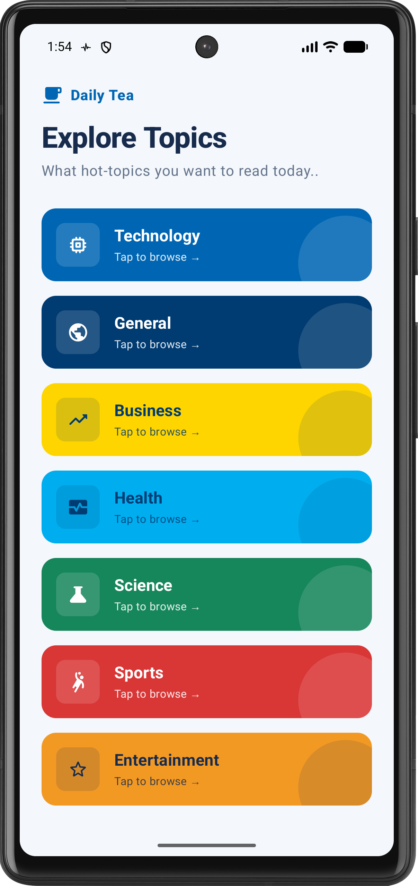
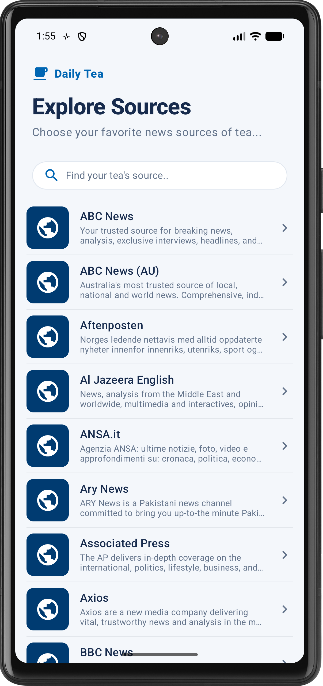
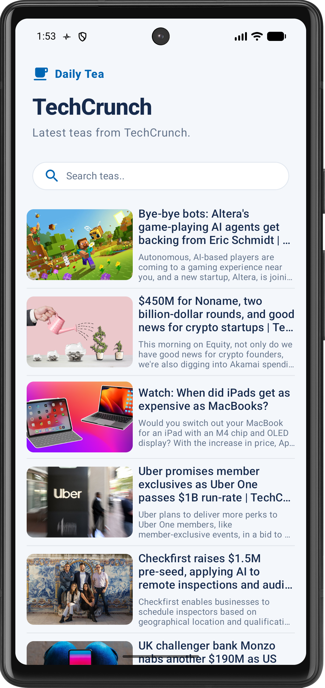

# Daily Tea App

Keep your day as hot as the Tea with latest updates from around the world.

## Screenshots

\

&#x20; \
&#x20; \
&#x20; \
\

## Demo Video

\<!-- Animated WebP preview -->

\
   \ \

## Third-Party API

This application uses [**NewsAPI**](https://newsapi.org/) to retrieve news articles and sources from around the world.

API endpoints used:

- **Top Headlines Sources:** Retrieves available news sources based on category, country, or language.
- **Top Headlines:** Fetches the latest articles from selected news sources.
- **Everything:** Searches for articles based on a search query and selected source.

For more information, visit the [NewsAPI Documentation](https://newsapi.org/docs).

### API Key

The application requires a NewsAPI API key to access news data. Configure your API key locally and avoid committing private API keys to the repository.
